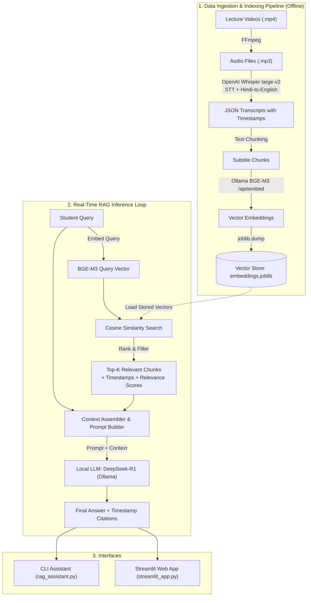

# 🎓 RAG-Based AI Teaching Assistant

[](https://www.python.org/)
[](https://streamlit.io/)
[](https://ollama.ai/)
[](https://huggingface.co/BAAI/bge-m3)
[](https://ollama.com/library/deepseek-r1)
[](https://github.com/openai/whisper)

A privacy-focused, **Retrieval-Augmented Generation (RAG)** assistant designed to answer student questions from lecture video courses. The system transforms raw lecture recordings into an indexed, searchable knowledge base, retrieving relevant lecture segments and generating contextual answers with **exact video numbers, titles, and timestamp citations**.

Currently indexed on the **Sigma Web Development Course**, featuring full local execution with **zero external API costs**.

---

## 📑 Table of Contents

- [Key Features](#-key-features)
- [System Architecture](#-system-architecture)
- [Tech Stack](#-tech-stack)
- [Repository Structure](#-repository-structure)
- [Quickstart (Ready-to-Use)](#-quickstart-ready-to-use)
- [Full Pipeline: Video to Knowledge Base](#-full-pipeline-video-to-knowledge-base)
- [User Interfaces](#-user-interfaces)
  - [Streamlit Web Interface](#1-streamlit-web-app)
  - [Command-Line Interface (CLI)](#2-command-line-interface-cli)
- [Deployment on Streamlit Cloud](#-deployment-on-streamlit-cloud)
- [Troubleshooting & FAQs](#-troubleshooting--faqs)
- [Future Roadmap](#-future-roadmap)
- [Author & Acknowledgments](#-author--acknowledgments)

---

## 🌟 Key Features

* **100% Local & Privacy-Preserving**: Runs completely offline using local models via Ollama. No data leaves your machine, and no paid API keys are required.
* **Audio Extraction & Multi-lingual Speech-to-Text**: Converts lecture videos (`.mp4`) into audio (`.mp3`), then transcribes and translates Hindi spoken lectures into structured English text using OpenAI Whisper (`large-v2`).
* **Dense Semantic Search with BGE-M3**: Encodes video subtitle chunks into rich dense vector embeddings using BAAI's `bge-m3` model and ranks relevant chunks using Cosine Similarity.
* **Reasoning with DeepSeek-R1**: Synthesizes clear, student-friendly explanations with `deepseek-r1:1.5b`, guided by custom system prompts enforcing course relevance.
* **Granular Timestamp Attribution**: Automatically references video titles and precise playback timestamps (`MM:SS - MM:SS`) so students can verify answers directly in course videos.
* **Dual User Interfaces**:
  * **Web Dashboard**: Modern Streamlit application with adjustable retrieval sliders (`top_k`, `temperature`), color-coded relevance scores, chunk breakdown tabs, and exportable answers.
  * **Interactive CLI**: Fast terminal query tool supporting both single queries (`-q`) and continuous interactive chat sessions.
* **Pre-Computed Knowledge Base**: Pre-extracted transcripts (`jsons/`) and vector database (`embeddings.joblib`) are included, allowing instant execution without needing to reprocess gigabytes of video.

---

## 🏗️ System Architecture



---

## 🛠️ Tech Stack

| Layer | Technology | Details |
| :--- | :--- | :--- |
| **Speech-to-Text** | [OpenAI Whisper `large-v2`](https://github.com/openai/whisper) | Hindi audio transcription + translation into English text with word/segment timestamps |
| **Media Processing** | [FFmpeg](https://ffmpeg.org/) | Video-to-audio extraction (`.mp4` to `.mp3`) |
| **Embedding Model** | [BAAI / BGE-M3](https://huggingface.co/BAAI/bge-m3) | Multilingual, dense embeddings served via Ollama (`/api/embed`) |
| **Vector Storage** | Pandas + [Joblib](https://joblib.readthedocs.io/) | Serialized in-memory vector index (`embeddings.joblib`) with cosine similarity |
| **Inference LLM** | [DeepSeek-R1:1.5B](https://ollama.com/library/deepseek-r1) | Local reasoning and response generation served via Ollama (`/api/generate`) |
| **Local LLM Runtime** | [Ollama](https://ollama.ai/) | Local model management and HTTP inference engine |
| **Web UI** | [Streamlit](https://streamlit.io/) | Interactive dashboard with parameter tuning, source inspection, and text export |
| **CLI** | Python `argparse` | Interactive terminal assistant with single-query and verbose modes |

---

## 📁 Repository Structure

```text
RAG_based_AI_Assistant/
├── .streamlit/
│   ├── config.toml             # Streamlit server, security, and theme settings
│   └── .gitignore              # Ignores runtime cache
├── jsons/                      # Structured JSON transcripts (18 lectures with timestamps)
│   ├── 01_Installing VS Code & How Websites Work.mp3.json
│   ├── 02_Your First HTML Website.mp3.json
│   └── ... (additional lecture transcripts)
├── audios/                     # Sample audio files extracted from videos (.mp3)
├── videos/                     # Source course lecture videos (.mp4)
│
├── retrieval.py                # EmbeddingEngine & RAGRetriever (similarity ranking, context formatting)
├── llm.py                      # OllamaLLM wrapper & prompt engineering (build_rag_prompt)
├── rag_assistant.py            # CLI query interface (interactive & single-query modes)
├── streamlit_app.py            # Streamlit web application
│
├── preprocess_json.py          # Indexes JSON chunks and builds embeddings.joblib
├── mp3_to_json.py              # Local Whisper transcription and translation script
├── videos_to_mp3.py            # FFmpeg audio extraction script
├── embeddings.joblib           # Pre-computed vector database containing embeddings & metadata
│
├── Collab_stt.ipynb            # Google Colab notebook for GPU-accelerated Whisper transcription
├── Collab_readme.md            # Documentation for the Colab transcription phase
│
├── requirements.txt            # Minimal runtime dependencies for local run & cloud deployment
├── DEPLOYMENT_CHECKLIST.md     # Step-by-step checklist for Streamlit Cloud deployment
├── DEPLOYMENT_READINESS.md     # Production deployment audit and architecture report
├── OLLAMA_SETUP_GUIDE.md       # Comprehensive Ollama hosting guide (Local, Ngrok, Cloud VM)
├── CHANGES_SUMMARY.md          # History of performance and deployment optimizations
└── README.md                   # Project documentation
```

---

## ⚡ Quickstart (Ready-to-Use)

The repository comes with **pre-computed embeddings** (`embeddings.joblib`) and **lecture transcripts** (`jsons/`). You do **not** need to download heavy videos or rerun Whisper to get started!

### 1. Prerequisites

- **Python**: 3.9, 3.10, or 3.11 installed
- **Ollama**: Installed and running ([Download Ollama](https://ollama.ai/download))

### 2. Clone the Repository & Set Up Virtual Environment

```bash
# Clone the repository
git clone https://github.com/your-username/RAG_based_AI_Assistant.git
cd RAG_based_AI_Assistant

# Create and activate a virtual environment
python -m venv venv

# On Windows:
.\venv\Scripts\activate

# On Linux/macOS:
source venv/bin/activate
```

### 3. Install Runtime Dependencies

```bash
pip install -r requirements.txt
```

### 4. Setup Ollama Models

Start the Ollama daemon if it is not already running:

```bash
ollama serve
```

In a separate terminal, pull the required embedding and generation models:

```bash
# Pull the embedding model (used by retrieval.py)
ollama pull bge-m3

# Pull the lightweight reasoning model (used by llm.py)
ollama pull deepseek-r1:1.5b
```

### 5. Launch the Application

#### Option A: Launch the Streamlit Web App

```bash
streamlit run streamlit_app.py
```
Open your browser at `http://localhost:8501`.

#### Option B: Run via the Command Line (CLI)

```bash
# Interactive conversation mode
python rag_assistant.py

# Or ask a single question directly
python rag_assistant.py --query "What is an HTML boiler plate and how does VS Code create it?"
```

---

## 🔄 Full Pipeline: Video to Knowledge Base

If you want to reproduce the ingestion pipeline or index your own courses from raw lecture recordings:

```text
[Raw Videos (.mp4)] ──(videos_to_mp3.py)──> [Audio (.mp3)] ──(mp3_to_json.py)──> [JSON Transcripts] ──(preprocess_json.py)──> [embeddings.joblib]
```

### Stage 1: Audio Extraction (`videos_to_mp3.py`)
Ensure [FFmpeg](https://ffmpeg.org/download.html) is installed and available in your system `PATH`. Place `.mp4` video files into `videos/` with the naming convention `<Title> #<Number>.mp4`:
```bash
python videos_to_mp3.py
```
*Output: Extracted `.mp3` files placed in `audios/`.*

### Stage 2: Transcription & Translation (`mp3_to_json.py` or Google Colab)
Transcribes audio into time-stamped text chunks and translates Hindi speech to English using OpenAI Whisper:
- **Local Execution**:
  ```bash
  pip install git+https://github.com/openai/whisper.git
  python mp3_to_json.py
  ```
- **Google Colab (Recommended if no local GPU)**:  
  Open [Collab_stt.ipynb](Collab_stt.ipynb) on Google Colab with a free T4 GPU runtime for 5-10x faster transcription. See [Collab_readme.md](Collab_readme.md) for instructions.

*Output: Structured JSON files saved in `jsons/` containing chunk metadata (`number`, `title`, `start`, `end`, `text`).*

### Stage 3: Embedding & Index Generation (`preprocess_json.py`)
Generates 1024-dimensional BGE-M3 embeddings for every transcript chunk via Ollama and saves the indexed DataFrame:
```bash
python preprocess_json.py
```
*Output: Serialized `embeddings.joblib` vector database.*

---

## 🖥️ User Interfaces

### 1. Streamlit Web App

The Streamlit interface (`streamlit_app.py`) provides an intuitive educational dashboard:

* **Interactive Query Box**: Enter questions about HTML, CSS, JavaScript, VS Code, and course topics.
* **Configurable Parameters**:
  * **Top-K Chunks**: Select how many lecture segments to retrieve (1 to 10).
  * **Temperature**: Adjust response creativity (0.0 for strict, 1.0 for creative).
* **Service Health Monitor**: Click **"Check Service Status"** in the sidebar to verify whether the Ollama server and embeddings are available.
* **Three Detailed Inspection Tabs**:
  * **📖 Retrieved Chunks**: Inspect the exact transcript text matched by the query with color-coded similarity badges:
    * 🟢 High Relevance (> 70%)
    * 🟡 Medium Relevance (40% - 70%)
    * 🔴 Low Relevance (< 40%)
  * **📍 Sources**: View quick reference chips showing Video Title, Video Number, and exact playback timestamps (`MM:SS`).
  * **📊 Metadata**: Comprehensive tabular breakdown of chunk IDs, video titles, similarity percentages, and time durations.
* **Export Feature**: Download the question, answer, and all cited sources into a clean `.txt` document with one click.

### 2. Command-Line Interface (CLI)

The CLI (`rag_assistant.py`) allows swift queries directly from the terminal without launching a browser:

```bash
# Interactive mode (type questions continuously, exit with Ctrl+C)
python rag_assistant.py

# Query mode (single question)
python rag_assistant.py -q "How do links and anchor tags work in HTML?"

# Custom top-k retrieved chunks
python rag_assistant.py -q "What is CSS?" -k 3

# Verbose debug mode (shows step-by-step latency & retrieval logs)
python rag_assistant.py -q "How to install VS Code?" --verbose
```

#### Example CLI Output

```text
======================================================================
🎓 RAG-Based Teaching Assistant - Web Development Course
======================================================================

----------------------------------------------------------------------
Question: What is an HTML boilerplate?
----------------------------------------------------------------------

📖 Answer:
An HTML boilerplate is the basic template structure required for any HTML web page. 
In Visual Studio Code, you can quickly generate this boilerplate by typing an exclamation 
mark (!) and pressing Enter or Tab. This automatically generates the doctype, html, head, 
and body tags.

----------------------------------------------------------------------
📚 Source References:
- Installing VS Code & How Websites Work (Video 1) @ 8:16 - 8:21
- Basic Structure of an HTML Website (Video 3) @ 0:45 - 1:12
----------------------------------------------------------------------

📊 Relevance Scores:
  1. Installing VS Code & How Websites Work (Video 1): 86.4%
  2. Basic Structure of an HTML Website (Video 3): 81.2%
  3. Your First HTML Website (Video 2): 64.7%
```

---

## ☁️ Deployment on Streamlit Cloud

When deploying to [Streamlit Community Cloud](https://streamlit.io/cloud):

1. **Lightweight Dependencies**: `requirements.txt` is already trimmed of heavy compilation dependencies (`ffmpeg-python`, `whisper`) to ensure fast build times and zero container timeouts.
2. **Pre-configured Settings**: `.streamlit/config.toml` includes cloud-ready headless execution, XSRF protection, and CORS rules.
3. **Connecting Ollama**: Since Streamlit Cloud does not run Ollama locally:
   * **For Development/Testing**: Expose your local Ollama port using **ngrok** (`ngrok http 11434`) or Cloudflare Tunnels, and set the URL in `retrieval.py` and `llm.py`.
   * **For Production**: Host Ollama on a cloud VM (AWS EC2 / GCP / DigitalOcean) or a container service.

👉 **Refer to the dedicated deployment guides:**
* [DEPLOYMENT_CHECKLIST.md](DEPLOYMENT_CHECKLIST.md) — Pre-flight verification checklist
* [DEPLOYMENT_READINESS.md](DEPLOYMENT_READINESS.md) — Architectural assessment and readiness report
* [OLLAMA_SETUP_GUIDE.md](OLLAMA_SETUP_GUIDE.md) — Complete guide for tunneling or hosting Ollama in the cloud

---

## ❓ Troubleshooting & FAQs

### 1. `ConnectionError: Cannot connect to Ollama at http://localhost:11434`
- **Cause**: The Ollama service is not running on your machine.
- **Fix**: Open a terminal and run `ollama serve`. Make sure you can visit `http://localhost:11434` in your browser.

### 2. `FileNotFoundError: Embeddings file not found: embeddings.joblib`
- **Cause**: The embeddings file is missing or has been deleted.
- **Fix**: Run `python preprocess_json.py` to regenerate the vector database from the files in `jsons/`.

### 3. `Ollama API error: model 'bge-m3' not found` or `'deepseek-r1:1.5b' not found`
- **Cause**: The models have not been downloaded yet.
- **Fix**: Run `ollama pull bge-m3` and `ollama pull deepseek-r1:1.5b`.

### 4. Running out of RAM on CPU-only machines
- Both `bge-m3` (~1.2 GB) and `deepseek-r1:1.5b` (~1.1 GB) are compact, quantized models designed to run comfortably even on modest machines with 8 GB of RAM.

---

## 🔮 Future Roadmap

- [ ] **Multi-Course Switcher**: Dynamic selector to toggle between different courses and video catalogs.
- [ ] **Conversational Memory**: Multi-turn dialogue support with question re-writing and session context.
- [ ] **Embedded Video Player**: Synchronized HTML5 video player that jumps straight to the cited timestamp on click.
- [ ] **Hybrid Search**: Combine BM25 keyword matching with BGE-M3 vector similarity for improved recall on technical syntax.
- [ ] **Voice Querying**: Direct speech input through the web browser.

---

## 👨‍💻 Author & Acknowledgments

**Ritesh Jat**  
B.Tech, Electronics and Communication Engineering  
Maulana Azad National Institute of Technology (MANIT), Bhopal  

### Acknowledgments
- Lecture content referenced from the **Sigma Web Development Course**.
- Built with [Ollama](https://ollama.ai/), [OpenAI Whisper](https://github.com/openai/whisper), [BAAI BGE-M3](https://github.com/FlagOpen/FlagEmbedding), [DeepSeek](https://www.deepseek.com/), and [Streamlit](https://streamlit.io/).
